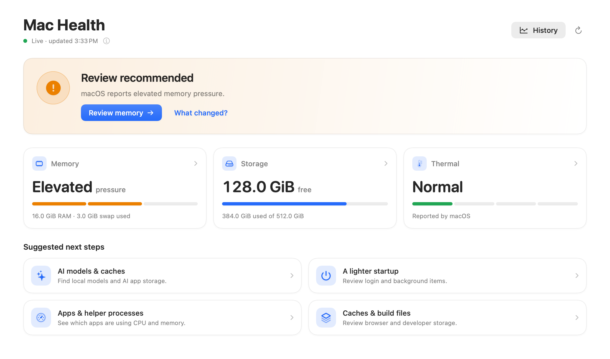
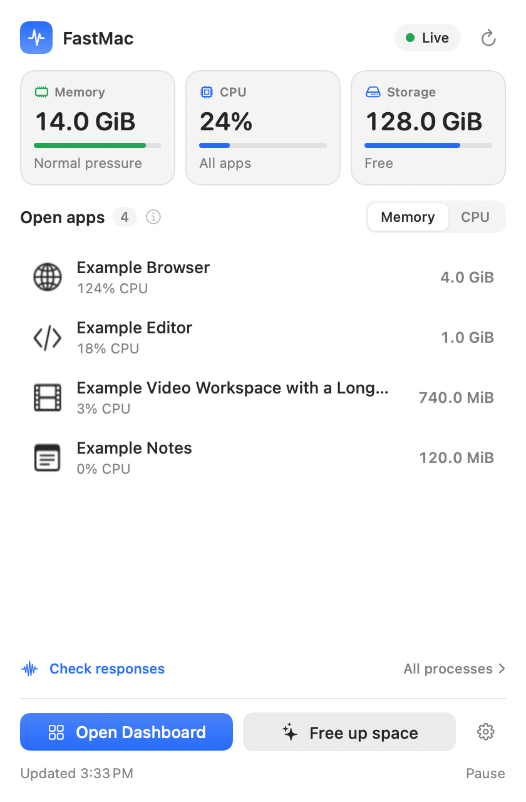
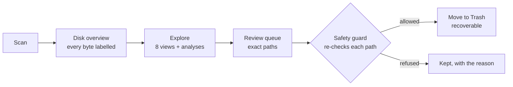
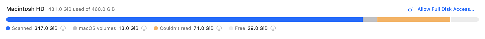

<div align="center">

# FastMac

**See what's slowing your Mac and what's filling it — then fix it safely.**

A free, open-source menu bar app for macOS. Health at a glance, every gigabyte accounted for,
and a cleanup flow that never removes anything you haven't reviewed.

[](https://github.com/ramsaicharan/fastmac/actions/workflows/ci.yml)
[](https://github.com/ramsaicharan/fastmac/releases/latest)


[](LICENSE)

<picture>
  <source media="(prefers-color-scheme: dark)" srcset="docs/screenshots/health-dark.png">
  
</picture>

</div>

## What it does

| | |
|---|---|
| **Mac Health** | Memory pressure, free storage and thermal state, read every 15 seconds, with one clear next step when something needs attention. |
| **Menu bar quick actions** | Live memory, CPU and storage. Open apps ranked by memory or CPU, with a confirmed Quit or Force Quit for the one you choose. |
| **Whole-Mac storage map** | Scans the entire startup disk — around 3 million files in a minute — and accounts for every byte: what it measured, what macOS keeps on its own volumes, what it couldn't read, and what's free. |
| **Eight ways to explore** | Treemap, sunburst, flame graph, bubbles, mind map, top sizes, age map and folders, plus quick wins, duplicates, and app footprints with leftovers. |
| **AI Storage** | Finds local models and caches from Ollama, Hugging Face, LM Studio, MLX and desktop AI apps — and protects conversation history from generic cleanup. |
| **Activity history** | Up to 30 days of local, per-minute samples. Compare apps over time, export CSV or JSON, and get optional alerts for low storage or sustained pressure. |
| **Startup & maintenance** | Review login and background items, and run admin tools (flush DNS, rebuild Spotlight) behind the system password prompt. |

Everything is free. No account, subscription, telemetry or third-party dependencies.

<p align="center">
  <picture>
    <source media="(prefers-color-scheme: dark)" srcset="docs/screenshots/menu-bar-dark.png">
    
  </picture>
</p>

## Install

### Download

1. Download `FastMac-<version>.zip` from the [latest release](https://github.com/ramsaicharan/fastmac/releases/latest).
2. Unzip it and drag **FastMac.app** into **Applications**.
3. Open it. FastMac isn't notarized by Apple yet, so the first launch is blocked with
   *"Apple could not verify FastMac"*. Click **Done**, then open
   **System Settings → Privacy & Security**, scroll to Security and click **Open Anyway**.
   You only need to do this once per version.
4. FastMac appears in the menu bar. Click it for quick actions, or choose **Open Dashboard**.

Each release lists the zip's SHA-256 checksum so you can confirm the download with
`shasum -a 256 FastMac-<version>.zip`.

### Build from source

Requires macOS 14 or later and Xcode 16 (or a Swift 6 toolchain).

```bash
git clone https://github.com/ramsaicharan/fastmac.git
cd fastmac
scripts/bundle.sh
open build/FastMac.app
```

`scripts/bundle.sh` builds a release binary, draws the app icon, writes the bundle and signs it
ad hoc. Copy `build/FastMac.app` to `/Applications` to keep it. To sign with your own
certificate, set `FASTMAC_SIGNING_IDENTITY` — see the [app guide](docs/app-guide.md).

## Permissions

FastMac asks only when a feature needs something, and works without any of these.

| Permission | What it unlocks | When it's requested |
|---|---|---|
| **Full Disk Access** | Measuring Mail, Messages, Safari and app containers in a whole-Mac scan | Before your first whole-Mac scan. FastMac opens the right page in System Settings and walks you through it |
| **Desktop, Documents, Downloads** | Measuring those folders | By macOS, the first time a scan reaches them |
| **Accessibility** | *Check responses*, which asks open apps whether they respond | Only when you use that check |
| **Notifications** | Optional alerts | Only if you turn alerts on |
| **Administrator password** | Admin tools such as rebuilding Spotlight | Each time you run one, through the standard macOS prompt |

## How it works



- **Scanning** is a parallel walk over raw POSIX calls (`opendir`, `readdir`, `fstatat`) across
  all cores. Sizes are allocated blocks on disk, symlinks are never followed, and nothing is
  read beyond file metadata.
- **Whole-disk accounting.** macOS shows your data twice: under `/Users`, `/Applications` and
  friends, and again under `/System/Volumes/Data`. FastMac walks it once, skips every other
  mounted volume, and fills in the rest from the volume APIs and `diskutil`: macOS's own volumes
  (Preboot, Recovery, VM, Update), space it couldn't read, purgeable space and free space.

  

- **Health monitoring** uses fixed-cost readings only: the kernel's memory-pressure level, VM
  statistics, volume capacity and thermal state. It never starts a folder scan.
- **Cleanup** has one gate. Every path is checked by a single safety guard that refuses system
  locations, protected folders (your home, Documents, Desktop, Library…) and anything outside
  your home folder, `/Applications` and external drives. It checks again immediately before
  moving. Items go to the Trash, so they stay recoverable; space is freed when you empty it.
  Recent moves are recorded in `~/.fastmac/cleanup.log`.
- **Quitting apps** confirms first and re-verifies the process identity (PID, start time and
  executable path), so a reused PID can never be quit by mistake.
- **Self-checks.** The app carries over 700 headless checks (`--checkall`, `--navigation-check`,
  render checks and more), run on every pull request.

More detail, including measurement caveats and limits, is in the [app guide](docs/app-guide.md).

## Privacy

FastMac runs entirely on your Mac. It makes no internet connections. Its only network
requests go to `127.0.0.1`, to list loaded models if you run Ollama or LM Studio, and it
refuses redirects anywhere else. Activity history stays in
`~/Library/Application Support/FastMac` and can be turned off or cleared in Settings.

## FAQ

**Why does the disk overview show "Couldn't read"?**
Some space is invisible to ordinary apps: folders protected by macOS privacy controls, admin-only
system data, the Spotlight index, document versions and local snapshots. Allowing Full Disk
Access shrinks it; the rest needs administrator rights to measure.

**I moved things to the Trash. Why didn't free space change?**
Moving to the Trash keeps files recoverable. The space is released when you empty the Trash.

**Will it make my Mac faster?**
It shows you what is actually using memory, CPU and storage so you can act on it. Quitting a
memory-heavy app helps when macOS reports memory pressure; freeing storage helps most when
the disk is nearly full. FastMac won't promise more than the measurements support.

**Why isn't it on the App Store?**
Measuring the whole disk and managing startup items need access the App Store sandbox doesn't
allow.

## Command-line tools

FastMac began as two terminal tools, which still live in [`cli/`](cli/README.md): `fastmac`
(scan, an interactive HTML report, duplicates, app footprints, a live delete-from-browser mode)
and `mactidy` (memory reporting and one-shot cache cleaning). They use only what ships with macOS.

## Contributing

Contributions are welcome — bug reports, ideas and pull requests. Read
[CONTRIBUTING.md](CONTRIBUTING.md) for how to build, run the checks and open a pull request.
Please report security issues privately as described in [SECURITY.md](SECURITY.md).

## License

[MIT](LICENSE) © 2026 Ram Sai Charan
